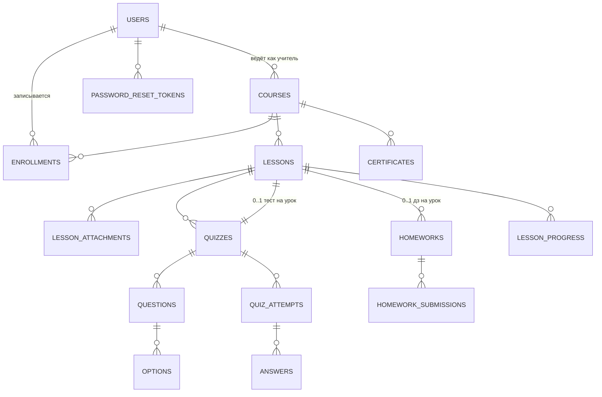

# SCHOOLSUN — план проекта (этап 1 из 7)

Образовательная платформа «школа солнца»: курсы → уроки → тесты с автопроверкой
→ домашние задания с проверкой учителем → прогресс, рейтинг, сертификаты.

## 1. Стек

| Слой | Технология |
|---|---|
| Язык | Java 17+ (на машине установлен **Java 21** — подходит) |
| Backend | Spring Boot 3.3: Web MVC, Security, Data JPA (Hibernate), Validation, Thymeleaf |
| Сборка | Maven (+ Maven Wrapper `mvnw`, чтобы не требовать установленный Maven) |
| БД | PostgreSQL 14+ (миграции Flyway; на время разработки возможен H2-file режим) |
| Frontend | Thymeleaf-шаблоны + ванильный JS + собственный CSS (БЭМ, по файлам на компонент) |
| Файлы | локальная папка `uploads/`, путь в `application.properties` |

## 2. Проверка окружения (выполнена)

- Java 21.0.12 LTS — ✅ есть
- Maven — ❌ нет → проект будет с Maven Wrapper (`mvnw.cmd`), установка не нужна
- PostgreSQL — ❌ нет → три варианта: установить Postgres / использовать H2 на время
  разработки (конфиг Postgres останется готовым) / поставить Docker (тоже отсутствует)
- Docker — ❌ нет

## 3. Архитектура (пакеты)

```
ru.schoolsun
├── config/        — SecurityConfig, MvcConfig, свойства приложения
├── common/        — обработчик ошибок, DTO, мапперы, утилиты
├── user/          — User, Role, регистрация, вход, восстановление пароля
├── course/        — Course, Enrollment, каталог, запись на курс
├── lesson/        — Lesson, Attachment, LessonProgress
├── quiz/          — Quiz, Question, Option, Attempt, Answer, автопроверка
├── homework/      — Homework, Submission, статусы проверки
├── rating/        — лидерборд, статистика учителя, экспорт CSV
├── certificate/   — генерация PDF-сертификата
└── upload/        — сервис хранения файлов
```

Каждый модуль: `Entity → Repository (Spring Data) → Service → Controller (+ DTO)`.

## 4. Схема БД (15 таблиц)



| Таблица | Поля (ключевое) | Назначение |
|---|---|---|
| `users` | id, email (uniq), password_hash, full_name, role `STUDENT/TEACHER/ADMIN`, avatar_path, is_blocked, created_at | все пользователи |
| `password_reset_tokens` | id, user_id→users, token (uniq), expires_at, used | восстановление пароля |
| `courses` | id, title, slug (uniq), description, subject, grade, accent (hex для дизайна карточки), sequential_mode (след. урок после сдачи предыдущего), teacher_id→users, is_published, created_at | курсы |
| `enrollments` | id, course_id, student_id, created_at; UNIQUE(course_id, student_id) | запись на курс |
| `lessons` | id, course_id, title, position, theory_md (markdown), video_url, is_published | уроки |
| `lesson_attachments` | id, lesson_id, stored_path, original_name, mime_type, size_bytes | вложения урока |
| `quizzes` | id, lesson_id (uniq), title, time_limit_sec, max_attempts, show_answers | тесты |
| `questions` | id, quiz_id, type `SINGLE/MULTI/MATCH/NUMBER/TEXT/OPEN`, text, points, position | вопросы |
| `options` | id, question_id, text, is_correct, pair_key (для типа «соответствие») | варианты ответа |
| `quiz_attempts` | id, quiz_id, student_id, attempt_no, started_at, finished_at, score, is_passed; UNIQUE(quiz_id, student_id, attempt_no) | попытки |
| `answers` | id, attempt_id, question_id, answer_payload (jsonb), is_correct, earned_points | ответы в попытке |
| `homeworks` | id, lesson_id (uniq), title, instruction, max_points, deadline_at | домашние задания |
| `homework_submissions` | id, homework_id, student_id, text_answer, file_path, submitted_at, status `SUBMITTED/REVISION/ACCEPTED`, score, feedback, graded_at, graded_by | сдачи дз |
| `lesson_progress` | id, lesson_id, student_id, completed_at; UNIQUE(lesson_id, student_id) | пройденные уроки |
| `certificates` | id, course_id, student_id, serial (uniq, формат `SCHOOLSUN-2026-0001`), issued_at | сертификаты |

**Рейтинг курса** считается запросом: сумма `quiz_attempts.score` + баллы принятых
`homework_submissions` ученика по курсу (без отдельной таблицы — меньше рассинхрона).

## 5. Безопасность

- BCrypt-хэши паролей; сессионная авторизация Spring Security.
- URL-правила: `/student/**` → STUDENT, `/teacher/**` → TEACHER, `/admin/**` → ADMIN,
  `/courses/**`, `/` — публично.
- Ограничение попыток входа (простой rate-limit фильтр по IP/email), лимит размера
  загружаемых файлов, экранирование пользовательского HTML, CSRF для форм.

## 6. Seed-данные (Flyway `V3__seed.sql`)

- Учитель: `teacher@schoolsun.ru` / `test1234`
- Ученики (5 шт.): `anna@schoolsun.ru`, `timur@…`, `liza@…`, `max@…`, `oleg@…` / `test1234`
- Админ: `admin@schoolsun.ru` / `test1234`
- Курсы: «Алгебра: от функций к олимпиадам» (математика, 8–9 кл., 12 уроков),
  «Механика: почему всё движется» (физика, 7–8 кл., 10 уроков),
  «Python с нуля до первого проекта» (информатика, 9 кл., 14 уроков) —
  у каждого 2–3 наполненных урока с тестом и домашним заданием, часть попыток
  и сданных дз для рейтинга.

## 7. Этапы работ (по промпту)

1. ✅ План + схема БД + макет фирменного стиля *(этот документ и макет)*
2. Скелет Spring Boot, Flyway, Spring Security, регистрация/вход/роли
3. Лендинг + каталог курсов (дизайн и анимации из макета)
4. Кабинет ученика: уроки, прогресс
5. Тесты и автопроверка (+ конфетти)
6. Домашние задания и панель учителя
7. Рейтинг, сертификаты PDF, тёмная тема, seed, README

## 8. Запуск (итоговый)

```bash
# нужна БД PostgreSQL (см. §2 — варианты)
./mvnw spring-boot:run        # Windows: mvnw.cmd spring-boot:run
# http://localhost:8080
```
